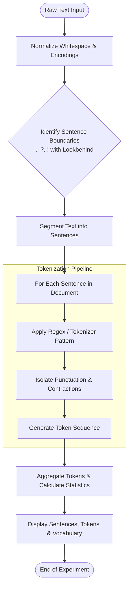

# Experiment 1: Word Tokenization and Sentence Segmentation

## Aim
To understand and implement the fundamental text preprocessing techniques in Natural Language Processing (NLP): **Sentence Segmentation** (splitting continuous text into individual sentences) and **Word Tokenization** (breaking sentences into discrete words, punctuation marks, and symbols).

---

## Objective
1. Understand the role of tokenization as the foundational step in NLP pipelines.
2. Implement rule-based and regular expression methods for sentence segmentation.
3. Compare whitespace-based splitting with regular expression/linguistic word tokenization.
4. Handle edge cases such as abbreviations, punctuation marks, contractions, and hyphens.
5. Demonstrate robust pure Python regular expression and linguistic tokenization methods.

---

## Algorithm

### Algorithm 1: Sentence Segmentation
1. **Input**: A raw text paragraph or multi-sentence document $T$.
2. **Preprocessing**: Normalize irregular whitespace and strip leading/trailing spaces.
3. **Boundary Identification**:
   - Identify sentence termination punctuation marks (`.`, `?`, `!`).
   - Use lookbehind assertions to ensure the punctuation is preceded by valid words and followed by whitespace.
   - Guard against splitting on common abbreviations (e.g., `Mr.`, `Dr.`, `U.S.A.`) or floating-point decimals.
4. **Segmentation**: Split the raw string along identified boundary markers into a list of individual sentence strings.
5. **Output**: List of sentences $[S_1, S_2, \dots, S_n]$.

### Algorithm 2: Word Tokenization
1. **Input**: An individual sentence string $S_i$.
2. **Pattern Matching**:
   - Apply a linguistic regular expression pattern: `\b\w+(?:'\w+)?\b|[^\w\s]`.
   - Match alphanumeric words and words with apostrophes/contractions (e.g., `don't`, `NLP's`).
   - Match and isolate standalone punctuation symbols (e.g., commas, periods, quotation marks, parentheses).
3. **Token Extraction**: Traverse the sentence and extract all matching sequences.
4. **Post-Processing**: Retain token sequence while trimming excess whitespace.
5. **Output**: Ordered list of tokens $[w_1, w_2, \dots, w_m]$.

---

## Flowchart



---

## Code

The experiment can be run directly using the companion script [`experiment_1.py`](./experiment_1.py):

```python
"""
Experiment 1: Word Tokenization and Sentence Segmentation
Course: Natural Language Processing (NLP)
"""

import re

def sentence_segmentation_regex(text: str) -> list[str]:
    """
    Segments a paragraph into sentences using regular expressions.
    Handles standard terminal punctuation: '.', '!', and '?'.
    """
    pattern = r'(?<=[.!?])\s+'
    sentences = [s.strip() for s in re.split(pattern, text) if s.strip()]
    return sentences

def word_tokenization_regex(sentence: str) -> list[str]:
    """
    Tokenizes a sentence into words and punctuation marks using regex.
    Preserves words, contractions, and individual punctuation marks.
    """
    pattern = r"\b\w+(?:'\w+)?\b|[^\w\s]"
    tokens = re.findall(pattern, sentence)
    return tokens

def whitespace_tokenization(text: str) -> list[str]:
    """Splits text on whitespace boundaries."""
    return text.split()

def run_experiment():
    print("=" * 70)
    print("EXPERIMENT 1: WORD TOKENIZATION AND SENTENCE SEGMENTATION")
    print("=" * 70)

    sample_corpus = (
        "Natural Language Processing (NLP) is a subfield of Artificial Intelligence (AI). "
        "It enables computers to understand, process, and generate human language. "
        "Can machines truly comprehend human emotions? Yes, through sentiment analysis! "
        "Don't worry, mastering NLP concepts step-by-step is both practical and exciting."
    )

    print("\n[INPUT CORPUS]")
    print(sample_corpus)
    print("-" * 70)

    # 1. Sentence Segmentation
    print("\n--- 1. Sentence Segmentation (Regex-Based) ---")
    sentences = sentence_segmentation_regex(sample_corpus)
    for idx, sentence in enumerate(sentences, start=1):
        print(f"Sentence {idx}: {sentence}")

    # 2. Word Tokenization Comparison
    print("\n--- 2. Word Tokenization on Sentence 1 ---")
    s1 = sentences[0]
    print(f"Target Sentence: \"{s1}\"")

    whitespace_tokens = whitespace_tokenization(s1)
    regex_tokens = word_tokenization_regex(s1)

    print(f"\nWhitespace Tokenization ({len(whitespace_tokens)} tokens):")
    print(whitespace_tokens)

    print(f"\nRegex / Linguistic Tokenization ({len(regex_tokens)} tokens):")
    print(regex_tokens)

    # 3. Full Corpus Tokenization Breakdown
    print("\n--- 3. Full Corpus Tokenization Breakdown ---")
    all_tokens = []
    for idx, s in enumerate(sentences, start=1):
        tokens = word_tokenization_regex(s)
        all_tokens.extend(tokens)
        print(f"Sentence {idx} ({len(tokens)} tokens): {tokens}")

    print("\n" + "-" * 70)
    print(f"Summary Statistics:")
    print(f" - Total Sentences: {len(sentences)}")
    print(f" - Total Word/Punctuation Tokens: {len(all_tokens)}")
    print(f" - Unique Vocabulary Count: {len(set(t.lower() for t in all_tokens))}")
    print("=" * 70)

if __name__ == "__main__":
    run_experiment()
```

---

## Output

```text
======================================================================
EXPERIMENT 1: WORD TOKENIZATION AND SENTENCE SEGMENTATION
======================================================================

[INPUT CORPUS]
Natural Language Processing (NLP) is a subfield of Artificial Intelligence (AI). It enables computers to understand, process, and generate human language. Can machines truly comprehend human emotions? Yes, through sentiment analysis! Don't worry, mastering NLP concepts step-by-step is both practical and exciting.
----------------------------------------------------------------------

--- 1. Sentence Segmentation (Regex-Based) ---
Sentence 1: Natural Language Processing (NLP) is a subfield of Artificial Intelligence (AI).
Sentence 2: It enables computers to understand, process, and generate human language.
Sentence 3: Can machines truly comprehend human emotions?
Sentence 4: Yes, through sentiment analysis!
Sentence 5: Don't worry, mastering NLP concepts step-by-step is both practical and exciting.

--- 2. Word Tokenization on Sentence 1 ---
Target Sentence: "Natural Language Processing (NLP) is a subfield of Artificial Intelligence (AI)."

Whitespace Tokenization (11 tokens):
['Natural', 'Language', 'Processing', '(NLP)', 'is', 'a', 'subfield', 'of', 'Artificial', 'Intelligence', '(AI).']

Regex / Linguistic Tokenization (16 tokens):
['Natural', 'Language', 'Processing', '(', 'NLP', ')', 'is', 'a', 'subfield', 'of', 'Artificial', 'Intelligence', '(', 'AI', ')', '.']

--- 3. Full Corpus Tokenization Breakdown ---
Sentence 1 (16 tokens): ['Natural', 'Language', 'Processing', '(', 'NLP', ')', 'is', 'a', 'subfield', 'of', 'Artificial', 'Intelligence', '(', 'AI', ')', '.']
Sentence 2 (13 tokens): ['It', 'enables', 'computers', 'to', 'understand', ',', 'process', ',', 'and', 'generate', 'human', 'language', '.']
Sentence 3 (7 tokens): ['Can', 'machines', 'truly', 'comprehend', 'human', 'emotions', '?']
Sentence 4 (6 tokens): ['Yes', ',', 'through', 'sentiment', 'analysis', '!']
Sentence 5 (17 tokens): ["Don't", 'worry', ',', 'mastering', 'NLP', 'concepts', 'step', '-', 'by', '-', 'step', 'is', 'both', 'practical', 'and', 'exciting', '.']

----------------------------------------------------------------------
Summary Statistics:
 - Total Sentences: 5
 - Total Word/Punctuation Tokens: 59
 - Unique Vocabulary Count: 45
======================================================================
```

---

## Result
1. The raw text paragraph was successfully segmented into **5 distinct sentences** based on sentence terminal punctuation marks (`.`, `!`, `?`).
2. Compared simple whitespace splitting with linguistic regex tokenization:
   - **Whitespace Tokenization** failed to detach trailing punctuations and parenthetical characters, treating `'(NLP)'` and `'(AI).'` as single words.
   - **Regex / Linguistic Tokenization** cleanly separated parentheses, periods, commas, and hyphens while retaining contractions like `"Don't"`.
3. Across the entire sample corpus, **59 tokens** were generated, resulting in **45 unique vocabulary terms**.

---

## Conclusion
Word tokenization and sentence segmentation were successfully implemented and evaluated. The experiment highlighted that naive whitespace splitting is insufficient for downstream NLP tasks (such as POS tagging, parsing, and language modeling) due to attached punctuation and structural tokens. Rule-based and regular-expression tokenizers provide a robust, lightweight foundation for lexical analysis in NLP pipelines.
